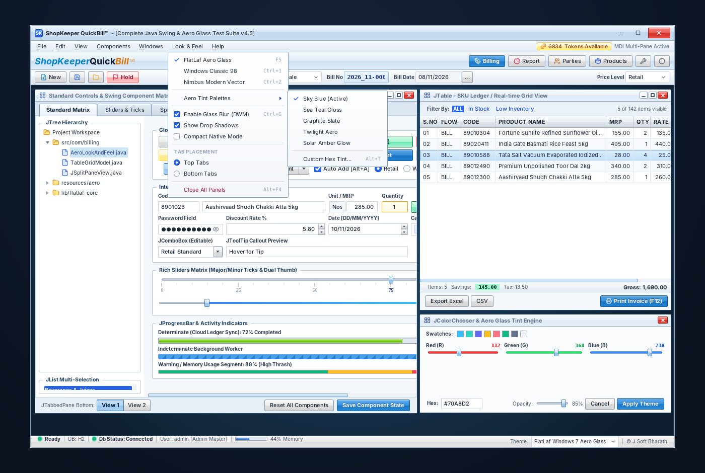

# Win-7 LAF - Win 7/Vista Aero Glossy Look Inspired


## Summary

**Win-7 LAF** is a complete custom Java Swing **Look and Feel** inspired by the glossy Windows 7 Aero look. Drop it into any Swing application to give every component a polished, glassy desktop appearance, with a custom title bar and a rich set of named button styles.


## Development Status

#### Note : Vibe Coded, In-Development - Bugs may exist - Use with caution - Report Bugs and Feature Requirements!!!

  

---

## ❤️ Support This Project

If you enjoy using this software, you can support 
its continued development!

### 🍕 Buy Me a Pizza  
<a href="https://buymeacoffee.com/sahasrarachakra?l=en">
  
</a>


## If you are an Indian Supporter
### 🇮🇳 Support via UPI

Scan this QR code using Google Pay, PhonePe or Paytm.


Thank you for supporting open-source development!

---

## Screens




## Features

- Complete Swing Look and Feel covering all standard components and `ComponentUI` delegates
- Many named **button styles** (primary, standard, error, success and more) with one uniform corner radius
- Custom title bar matching the Windows 7 design
- Glossy toolbars, menus and menu bars
- Internal frames with smaller corners and flat (no bevel) borders
- Editable combo box with a clean button border
- Smooth text anti-aliasing
- Easy one-line installation

## Prerequisites for Running

- This is a **library for Java developers**, not a stand-alone program
- A Java application (Swing) running on **Java 17 or later**

## How to Run

1. Download the latest `Win7-LAF.jar` from the **Releases** page.
2. Add it to your application's classpath (or to the `lib/` folder of your IDE project).
3. Install the look and feel before creating any Swing component:

```java
import javax.swing.UIManager;

public class Demo {
    public static void main(String[] args) throws Exception {
        UIManager.setLookAndFeel("com.jsoft.win7laf.Win7LookAndFeel");
        javax.swing.SwingUtilities.invokeLater(() -> {
            // create and show your JFrame here
        });
    }
}
```

Or start any existing Swing app with it from the command line:

```bash
java -Dswing.defaultlaf=com.jsoft.win7laf.Win7LookAndFeel -cp Win7-LAF.jar;yourapp.jar com.example.Main
```

## How to Use

- **Install:** call `UIManager.setLookAndFeel("com.jsoft.win7laf.Win7LookAndFeel")` once, at startup, before building the UI.
- **Button styles:** select a button style by name using a client property, for example:

```java
button.putClientProperty("JButton.style", "primary"); // primary, standard, error, success ...
```

- **Custom title bar:** enable it with `JFrame.setDefaultLookAndFeelDecorated(true);` before creating your frame.
- **Everything else:** standard Swing components (menus, toolbars, tables, trees, tabs, combo boxes, internal frames, etc.) pick up the look automatically.

<!-- Replace the class name and property keys above with the real ones from your source. -->

## Button styles
`AeroButtons.style(btn, "primary")` or `btn.putClientProperty("JButton.style","primary")`
standard, primary, accent (print), success, error, danger (hold), warning, info, flat, link, outline, segment, caption, close.
Aliases: default/ribbon, print, cancel/abort, hold, commit/add, toolbar/ghost, secondary/neutral.
Segmented groups `AeroButtons.segmented(...)`, split button `AeroButtons.split(...)`, icon buttons `AeroButtons.icon("save", tip, style)`.
Custom: `AeroButtonStyle.register("brand", state -> new Spec()...)`.

## Title bar Icon Badge (Before Title)
Badge text: `UIManager.put("Aero.titleBadgeText","AB")`.


## Client properties
```Java
    JButton.style, JButton.segmentPosition 
    JTextField.style (info, highlight) 
    JComponent.outline (error, warning, success) 
    JTextField.placeholderText,
    showClearButton, leadingIcon, trailingIcon 
    JPasswordField.showRevealButton 
    JCheckBox.indeterminate 
    JLabel.style (title, muted, error, success...) 
    JPanel.style (ribbon, toolbar, statusbar, glass, header, group, tabbody, navy) 
    JToolBar.style (ribbon) 
    JProgressBar.style (blue, warning, error, segmented, mini) 
    JSlider.trackColor, JSlider.trackFill 
    JMenuItem.header, JMenuItem.destructive 
    JRadioButtonMenuItem.checkStyle
```
## Runtime theming
`AeroLookAndFeel.applyTint(Tint.SEA_TEAL)`, `applyCustomTint(Color)`, `setCompact(true)`.

## Extra components (not in stock Swing)
AeroRangeSlider (dual thumb), AeroTagField (chips), AeroStatusBar, AeroBorders.group("Title").

## All 43 Swing UI delegates are implemented
Button, ToggleButton, CheckBox, RadioButton, CheckBoxMenuItem, RadioButtonMenuItem, MenuItem, Menu, MenuBar, PopupMenu, PopupMenuSeparator, Separator, ToolBarSeparator, ToolBar,
TextField, PasswordField, FormattedTextField, TextArea, TextPane, EditorPane, ComboBox, List, ScrollBar, ScrollPane, Slider, Spinner, SplitPane, TabbedPane, Table, TableHeader, Tree,
ProgressBar, Label, Panel, Viewport, ToolTip, OptionPane, FileChooser, ColorChooser, InternalFrame, DesktopPane, DesktopIcon, RootPane.

Run `java -cp win7-laf.jar aero.demo.Showcase` (the design rebuilt) or `aero.demo.Gallery` (headless catalogue render).


## Prerequisites for Building

- **JDK 17 or later**
- An IDE (NetBeans / IntelliJ IDEA / VSCodium) or the command line
- Git

## How to Build

1. Clone the repository:

```bash
git clone https://github.com/SahasraraChakra/Win7-LAF.git
cd Win7-LAF
```

2. **Using an IDE:** open the project in NetBeans (or IntelliJ IDEA / VSCodium with Java extensions), make sure the project JDK is 17+, add the libraries from the `lib/` folder to the classpath, then choose **Run / Build**.

3. **Using the command line:**

```bash
# Windows (use ':' instead of ';' on Linux/macOS)
mkdir out
javac -cp "lib/*" -d out -sourcepath src src/com/jsoft/laf/DemoApp.java
jar cfe Win7-LAF.jar DemoApp -C out .
```

> Adjust the main class and paths above to match your project layout. Copy any resource folders (fonts, images, `.properties` themes) into the output before packaging, if your IDE does not do this automatically.

## Copyright

© JSoft Bharath, Kerala, India & Jeevan Kumar Vishwakarman. All rights reserved.

**Win-7 LAF - Win 7 Glossy Look Inspired Developed By : JSoft Bharath, Kerala, India. / Jeevan Kumar Vishwakarman. All Rights Reserved To : JSoft Bharath, Kerala, India. / Jeevan Kumar Vishwakarman.**

## License

**Attribution-Required, No-Modification, No-Resale License**

Copyright © JSoft Bharath, Kerala, India & Jeevan Kumar Vishwakarman ("the Authors").

Permission is hereby granted, free of charge, to any person or organization obtaining a copy of this software and its source code ("the Software") to **use** the Software, for personal or commercial purposes, subject to the following conditions:

1. **Attribution is compulsory.** Any use of the Software, in any application, product, service, documentation or website, must display the following attribution text, in bold, in a place reasonably visible to users (for example an About dialog, credits screen, README or product page):

   **Win-7 LAF - Win 7 Glossy Look Inspired Developed By : JSoft Bharath, Kerala, India. / Jeevan Kumar Vishwakarman. All Rights Reserved To : JSoft Bharath, Kerala, India. / Jeevan Kumar Vishwakarman.**

2. **No modification.** You may not change, modify, adapt, translate, decompile, reverse-engineer or create derivative works of the Software's code or binaries. The Software must be used exactly as distributed by the Authors.

3. **No selling or charging for the Software.** You may not sell, rent, sublicense, or charge any fee for the Software or its code, in whole or in part, or bundle it in a way that charges for the Software itself. You **may** charge for your own applications, products and services that use the Software, provided the Software itself is not what is being sold and condition 1 is met.

4. **Redistribution.** You may redistribute the unmodified Software free of charge only if this license, the copyright notice and the attribution text are kept intact.

5. **Ownership.** The Software is licensed, not sold. All rights not expressly granted are reserved by the Authors.

6. **Termination.** Any breach of these terms automatically terminates your rights under this license.

THE SOFTWARE IS PROVIDED "AS IS", WITHOUT WARRANTY OF ANY KIND, EXPRESS OR IMPLIED, INCLUDING BUT NOT LIMITED TO THE WARRANTIES OF MERCHANTABILITY, FITNESS FOR A PARTICULAR PURPOSE AND NONINFRINGEMENT. IN NO EVENT SHALL THE AUTHORS BE LIABLE FOR ANY CLAIM, DAMAGES OR OTHER LIABILITY, WHETHER IN AN ACTION OF CONTRACT, TORT OR OTHERWISE, ARISING FROM, OUT OF OR IN CONNECTION WITH THE SOFTWARE OR THE USE OR OTHER DEALINGS IN THE SOFTWARE.

For permission requests beyond these terms, contact the Authors via the repository's Issues page.
